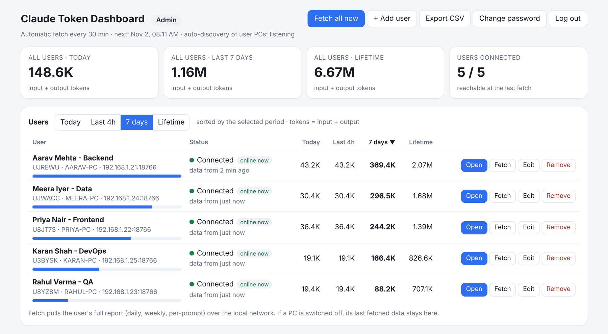
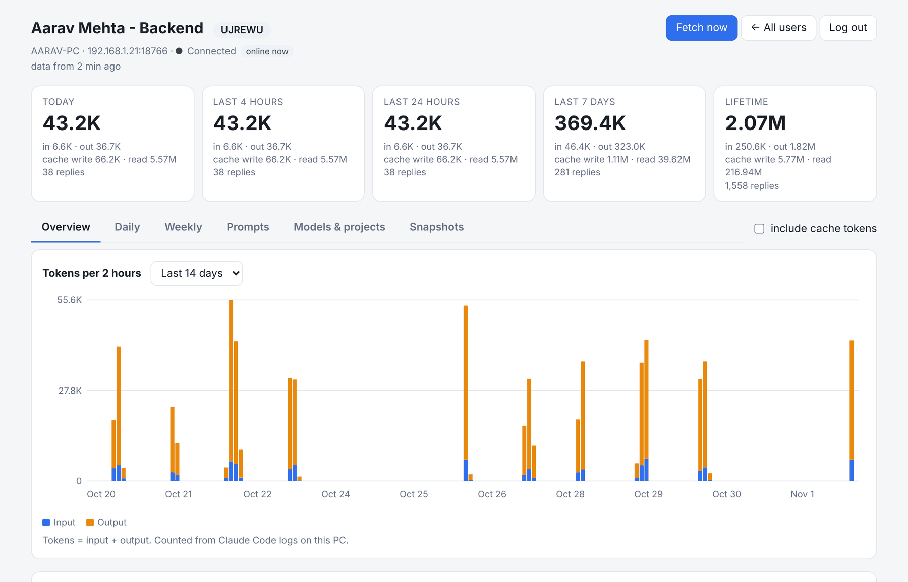
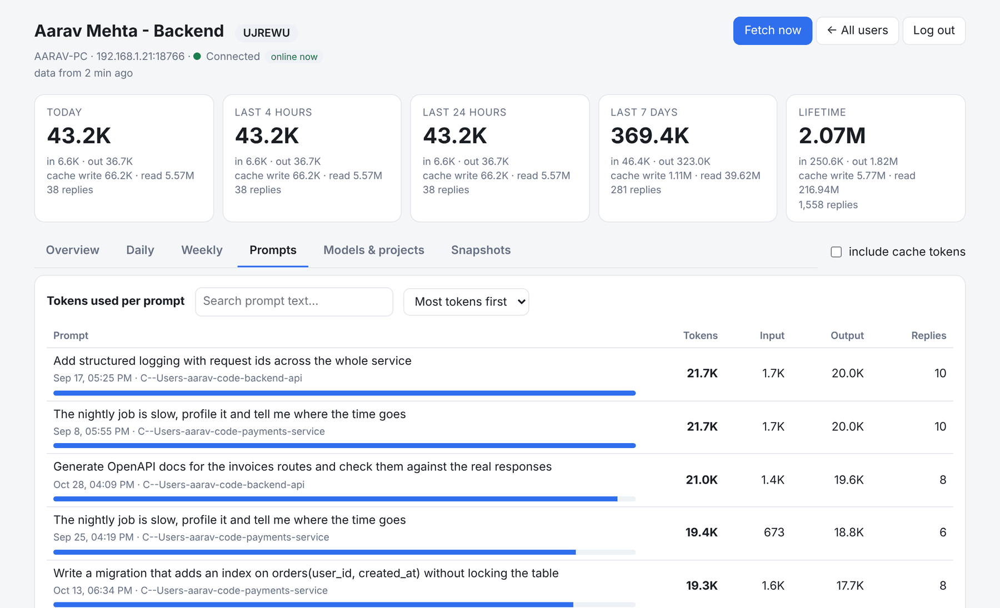
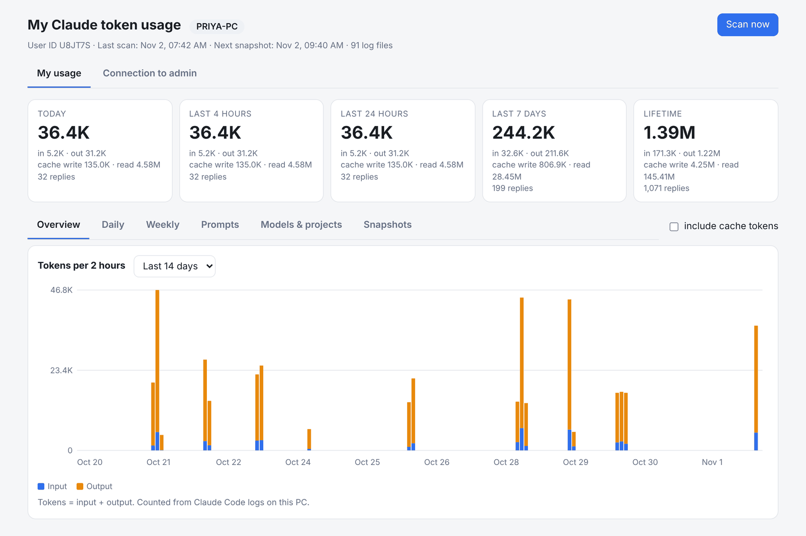
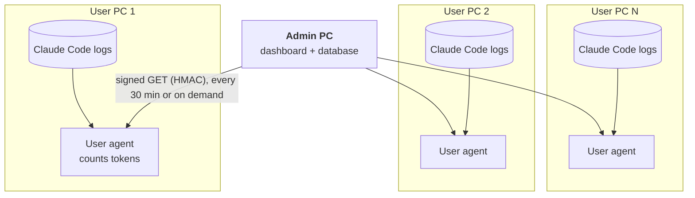
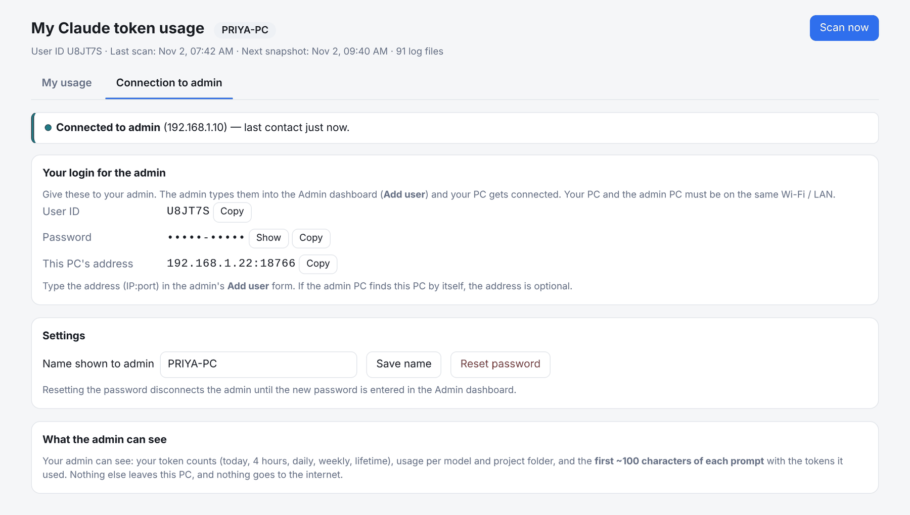

<div align="center">

# Claude Token Dashboard

**One Claude plan, many PCs. See exactly which PC (and which prompt) burns the tokens.**<br>
Works on your own Wi-Fi / LAN. No cloud, no Anthropic API key, no extra Python packages.

[](LICENSE)


<picture>
  <source media="(prefers-color-scheme: dark)" srcset="docs/img/admin-overview-dark.png">
  
</picture>

<sub>Demo data. Five fake users, generated logs.</sub>

</div>

---

## The problem

You have **one Claude account (or one team plan) and it is used from several PCs**.
Claude Code is running in VS Code on the developer's laptop, on the QA machine, on the build server...

Then somebody asks:

> *"Who is using how many tokens? Which PC? Which prompts are the expensive ones?"*

Anthropic's own usage reports are built around the **account / user**. As far as the public docs show, they do not split one login by the PC it was used on. So five PCs on one login look like one big number.

## The fix

A tiny agent on each PC reads that PC's **local Claude Code logs** and counts the tokens.
One admin PC collects everybody's numbers over the **same Wi-Fi / LAN**.

- **Users** see only **their own** usage: today, last 4 hours, daily, weekly and tokens per prompt.
- **The admin** sees **everyone**: who used how much, when, in which project, with which prompt.

<table>
<tr>
<td width="50%" valign="top">

**Admin: all users, one screen**

Sort by today / last 4 h / 7 days / lifetime. See who is online. Fetch one user or all, export CSV.

<picture>
  <source media="(prefers-color-scheme: dark)" srcset="docs/img/admin-overview-dark.png">
  
</picture>

</td>
<td width="50%" valign="top">

**Admin: open any user**

Input vs output tokens in 2-hour buckets, daily and weekly tables, models and project folders.

<picture>
  <source media="(prefers-color-scheme: dark)" srcset="docs/img/admin-user-detail-dark.png">
  
</picture>

</td>
</tr>
<tr>
<td width="50%" valign="top">

**Tokens per prompt**

Which prompt cost the most? Search, sort by cost, see replies per prompt and the project it ran in.

<picture>
  <source media="(prefers-color-scheme: dark)" srcset="docs/img/admin-prompts-dark.png">
  
</picture>

</td>
<td width="50%" valign="top">

**Each user's own dashboard**

Every user can look at their own numbers. Nobody else's.

<picture>
  <source media="(prefers-color-scheme: dark)" srcset="docs/img/user-dashboard-dark.png">
  
</picture>

</td>
</tr>
</table>

## Features

- **Per PC and per person.** Tokens today, last 4 hours, last 24 hours, 7 days, lifetime.
- **Per prompt.** Every prompt with the tokens it used (all replies and sub-agent replies are added up).
- **Daily, weekly and 2-hour charts**, input vs output, optional cache tokens.
- **Admin + User roles.** A user can never see another user's data. The admin sees everything.
- **Pairing like a Wi-Fi password.** Each PC creates a User ID and a password on first start. The admin types them in once.
- **Auto-discovery.** The admin finds user PCs on the LAN by itself (IP address is optional).
- **Runs in the background.** Hidden, starts with Windows, restarts itself if it crashes. No terminal needed.
- **Python installs itself.** If a PC has no Python, the installer downloads the official one for the current user and sets `PATH`. No admin rights needed.
- **Zero dependencies.** Python standard library only. SQLite for storage.
- **CSV export** of everybody's daily usage.
- **Light and dark mode**, works on a phone screen too.

## How it works



1. The **user agent** reads the new lines of the Claude Code log files about once a minute, removes duplicate (streamed) replies, and keeps the counts in a local SQLite file. A snapshot is stored every 2 hours.
2. The **admin** pulls each user's report every 30 minutes, or any time you press *Fetch*. User PCs only answer; they never push anything (they just send a tiny UDP "I am here" broadcast, so the admin can find them by itself). If a PC is off, its last data stays on the admin dashboard.
3. Every request is **signed with the user's password** (HMAC-SHA256) and every answer is signed back. The password itself never travels over the network.

## Quick start

> **Windows 10 / 11.** Nothing to install by hand. Python is fetched automatically if it is missing (internet needed once per PC).

**1. Admin PC (one PC)**

1. Download this repo (**Code → Download ZIP**) and unzip it.
2. Open `Admin_Setup` and double-click **`install_admin.vbs`**.
3. The admin dashboard opens in your browser. Create the admin password.
4. Click **Download User Setup (to share)** and send `User_Setup.zip` to your users (WhatsApp, e-mail, pen drive...).

**2. Every user PC**

1. Unzip `User_Setup` somewhere permanent and double-click **`install_user.vbs`**.
2. The user's dashboard opens and shows a **User ID** and a **Password**. The user gives these two to the admin.

**3. Admin connects the user**

In the admin dashboard click **+ Add user**, type the User ID and Password, **Add & connect**. Done. The user's page turns green.

<picture>
  <source media="(prefers-color-scheme: dark)" srcset="docs/img/user-connection-dark.png">
  
</picture>

Upgrading from an older copy, or something does not connect? Double-click `clean_old_versions.bat` on every PC first. The full guide is in [`README_FIRST.txt`](README_FIRST.txt).

<details>
<summary><b>Linux / macOS</b></summary>

There is no installer, but the code is plain Python 3.8+ with no packages:

```bash
cd Admin_Setup && ./start_admin.sh      # admin PC
cd User_Setup  && ./start_dashboard.sh  # every user PC
```

Tested on Linux. macOS should work the same way but is untested.
</details>

## Who can see what

| | Own numbers | Other users' numbers | Prompt text |
|---|:---:|:---:|---|
| **User** | yes | **no** | own prompts |
| **Admin** | yes | yes | first ~100 characters of each prompt (can be turned off) |

Privacy is explicit. The user's **Connection** tab lists exactly what the admin can see. To hide prompt text from the admin, set `"share_prompt_text": false` in `User_Setup/config.json`.

## Security and privacy

- Nothing goes to the internet. The only network traffic is **PC to admin PC on your own LAN**.
- Passwords are never sent. Requests are HMAC-signed, answers are signed back, replayed and forged requests are rejected, wrong attempts are rate-limited.
- The admin dashboard needs a login, uses `HttpOnly` / `SameSite=Strict` cookies, CSRF headers and a Host-header check. By default it listens on this PC only (`lan_access: false`).
- **The data itself is plain HTTP on the LAN, not encrypted.** Use it on a network you trust.
- Only token counts and the first ~100 characters of prompts are shared. Never your code, files or answers.

## What it counts (and what it does not)

- It counts **Claude Code** (VS Code extension and CLI) from the log files on each PC.
- It does **not** count claude.ai chats, the mobile app or Cowork.
- "Tokens" = input + output. Tick *include cache tokens* to add cache reads and writes.
- *Lifetime* is whatever is still in the PC's Claude Code logs. If Claude Code deletes old logs, they are gone here too.
- It is **not** the official bill. Use Anthropic's own reports for billing. This tool answers "which PC / person / prompt", which those reports do not split.
- Same Wi-Fi / LAN is required. It does not work across the internet on purpose.

## Project layout

```
Admin_Setup/      admin.py + dashboard.   One PC.
User_Setup/       user.py + dashboard.    Every user PC.
_shared/          report.js, common.css, find_python.bat, ensure_python.bat (copied into both setups)
clean_old_versions.bat   stops old copies before an upgrade
README_FIRST.txt         step by step guide
docs/img/                screenshots (generated demo data)
```

## Status and contributing

The Windows installer scripts are young and have been run on a few real PCs, not on every Windows setup. If something fails, please open an issue and paste the last lines of `data\user.log` (or `data\admin.log`).

Ideas, bug reports and pull requests are welcome. Some ideas: macOS / Linux autostart, optional TLS between PCs, an optional Slack or e-mail alert when a user crosses a daily limit, import of Anthropic's spend CSV to show it next to the per-PC numbers.

<details>
<summary><b>Hinglish me short summary</b></summary>

Ek Claude account kai PCs par chal raha hai to Anthropic ke reports me sab ek hi user dikhta hai. Is tool me har PC par ek chhota agent apne Claude Code logs se tokens ginta hai. Ek admin PC same Wi-Fi / LAN par sabka data fetch karta hai. User ko sirf apna data dikhta hai (daily, weekly, har prompt ke tokens), admin ko sabka. Python na ho to khud install ho jata hai. Cloud ya API key ki zarurat nahi.
</details>

## Disclaimer

Unofficial community project. It is **not affiliated with, endorsed by or supported by Anthropic**. "Claude" is a trademark of Anthropic. The screenshots use generated demo data, not real usage.

## License

[MIT](LICENSE) © 2026 Kenil Sojitra
